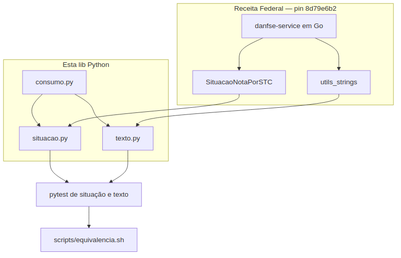

# calculadora-rtc-gerador-danfse

DANFSe em Python. É uma implementação independente do gerador que a Receita Federal publicou em Go, no commit pinado. Não é um fork: o código Go não entra neste repositório.

Não é projeto oficial, produto homologado, certificado ou mantido pela Receita Federal do Brasil nem pelo Serpro. Não é parecer, orientação ou consultoria tributária. A suíte do pin não cobre cenário que ela não executa e não substitui a legislação.

**Nossas** (esta implementação em Python, MIT, Copyright (c) 2026 Garuso Cruz)

[](https://pypi.org/project/calculadora-rtc-gerador-danfse/)
[](LICENSE)
[](cloudbuild.yaml)

**Do pin oficial** (danfse-service 1.0.0, commit `8d79e6b2`, MIT, Copyright (c) 2026 Receita Federal do Brasil)

[](https://github.com/ReceitaFederal/calculadora-rtc-gerador-danfse/commit/8d79e6b2f7fad6375340afcb51c85ed370c64a14)
[](LICENSE-RECEITA.md)

A cobertura desta lib conta sentenças Python. O mínimo é 80%. O detalhe do último run fica em [Última validação](#ultima-validacao).

| | |
| --- | --- |
| Fonte oficial | [ReceitaFederal/calculadora-rtc-gerador-danfse](https://github.com/ReceitaFederal/calculadora-rtc-gerador-danfse) |
| Versão oficial do pin | danfse-service `1.0.0`, commit de 2026-10-22 |
| Commit pinado | [`8d79e6b2f7fad6375340afcb51c85ed370c64a14`](https://github.com/ReceitaFederal/calculadora-rtc-gerador-danfse/commit/8d79e6b2f7fad6375340afcb51c85ed370c64a14) |
| Licenças | [LICENSE](LICENSE) (nossa) e [LICENSE-RECEITA.md](LICENSE-RECEITA.md) (Receita, sobre o Go do pin) |

## Índice

- [Limite de uso](#limite)
- [Arquitetura](#arquitetura)
- [Equivalência](#equivalencia)
- [Última validação](#ultima-validacao)
- [Atualização do pin](#atualizacao-do-pin)
- [Instalação](#instalacao)
- [Consumo](#consumo)
- [Licença](#licenca)

## Fora do escopo

Quem consome chama `calculadora_rtc_gerador_danfse.consumo`. O servidor Echo, o WASM, o Swagger e a telemetria ficam no Go. Esta lib não sobe API, não emite NFS-e e não chama a Sefin.

O cálculo de CBS e IBS não mora aqui. Ele está nas libs `calculadora-rtc-regime-regular` e `calculadora-rtc-simples-nacional`.

<a id="limite"></a>

## Limite de uso

O resultado depende do insumo e da cobertura da suíte. Uso em documento fiscal exige conferência independente. A publicação do código pela Receita não homologa esta implementação.

| O que | Nesta versão |
| --- | --- |
| `SituacaoNotaPorSTC` e `MarcaDagua` | os casos de `situacao_test.go` |
| `SanitizarAmpersand` | os quatro `TestSanitizarAmpersand_*` |
| `TruncarTexto` e `TruncarPorTamanho` | o corte com reticências; o pin não tem teste Go dessas duas |
| PDF do folio, layout, apresentador e localidades | fora desta equivalência |
| Servidor Echo, WASM, Swagger e telemetria | ficam no Go do pin |
| Emissão de NFS-e e chamada à Sefin | não |
| Parecer ou enquadramento tributário | não |

<a id="arquitetura"></a>

## Arquitetura



A seta do diagrama é a regra portada do pin. O CI não executa o binário Go. `situacao.py` resolve o `stc`. `texto.py` trata o `&` solto e o corte. Os dois não se importam. A fachada não desenha o PDF.

<a id="equivalencia"></a>

## Equivalência

A equivalência com a aplicação Go é só a tabela abaixo, no pin `8d79e6b2`. A suíte repete o caso do teste Go quando esse teste existe. Ela não executa `go test` e não compara o PDF.

| Go do pin | Python | O que a suíte garante |
| --- | --- | --- |
| `SituacaoNotaPorSTC` | `situacao_por_stc` | `stc` 0 válida, 1 substituída, 2 cancelada; 3 válida e não reconhecida, como `situacao_test.go` |
| `MarcaDagua` | `marca_dagua` | `CANCELADA`, `SUBSTITUÍDA` e vazio na válida |
| `SanitizarAmpersand` | `sanitizar_ampersand` | os quatro `TestSanitizarAmpersand_*`: a entidade fica, o `&` solto vira `&amp;`, o texto sem `&` fica, a mistura escapa só o solto |
| `TruncarTexto`, `TruncarPorTamanho` | `truncar_texto`, `truncar_por_tamanho` | o corte reserva as reticências. `utils_strings` não tem teste Go dessas duas |

`TruncarComReticencias` está na fachada. A suíte ainda não cobre essa função.

Fora da tabela ficam o renderer folio, o layout, o apresentador, o catálogo de localidades, os totais, o Echo, o WASM, o Swagger e a telemetria.

O passo continua se chamando `equivalencia`, como nas outras calculadoras. Nesta lib ele roda esse pytest. Não clona o Go do pin. Os percentuais da Última validação são do último run que gravou o README, não deste commit.

O gancho `scripts/hooks/pre-push.sh` chama `scripts/equivalencia.sh` depois da auditoria de versão e dos quality gates. O CI é o Cloud Build, sem workflow do GitHub Actions. A pull request dispara `calculadora-rtc-gerador-danfse-pr` e não publica. O push na `main` dispara `calculadora-rtc-gerador-danfse-main`. Depois do quality gate, o mesmo run faz o build da lib, grava o README com esse build e com esse run, publica no PyPI, abre a tag `vX.Y.Z` e abre a pull request que devolve o README para a `main`. O merge dessa pull request vê a versão já publicada e não repete o build.

A release `v0.1.1` é essa versão no GitHub.

<!-- release-runs:start -->
Release `v0.1.2` em 2026-11-24. Build [`af2d6144-0e06-4a21-aa5e-a5800c6b6a8c`](https://console.cloud.google.com/cloud-build/builds;region=us-central1/af2d6144-0e06-4a21-aa5e-a5800c6b6a8c?project=lynko-508200) no commit `fb23e10b616a3234bb676ee31a81a5a78f9c3629`.
Pacote deste run: `calculadora_rtc_gerador_danfse-0.1.2.tar.gz` e `calculadora_rtc_gerador_danfse-0.1.2-py3-none-any.whl`.
<!-- release-runs:end -->

A tag `vX.Y.Z` dispara `calculadora-rtc-gerador-danfse-release`. Esse passo não publica de novo: confere o README e que o PyPI já tem a versão gravada no bloco abaixo.

```bash
export PATH="${HOME}/.local/bin:${HOME}/.asdf/shims:${PATH}"
cd libs/calculadora-rtc-gerador-danfse
bash scripts/hooks/pre-push.sh
```

Só imprime `pre-push OK` quando a auditoria de versão, os quality gates e a suíte do pin passam.

| Gate | O que confere | Falha se |
| --- | --- | --- |
| Versão | `scripts/hooks/audit-version.sh` contra `origin/main` | a aplicação mudou e o `MAJOR.MINOR.PATCH` não subiu |
| Pytest | `python3 -m pytest` com cobertura mínima de 80% | a suíte falha ou a cobertura fica abaixo |
| Trivy | `v0.74.0`, HIGH e CRITICAL | o scan acha achado que falha o build |
| Pin | os casos Go da tabela acima, mais o corte com reticências | a suíte falha ou a fachada expõe desenho |

<a id="ultima-validacao"></a>

## Última validação

Data: 24 de novembro de 2026. Os números abaixo são do Cloud Build [`af2d6144-0e06-4a21-aa5e-a5800c6b6a8c`](https://console.cloud.google.com/cloud-build/builds;region=us-central1/af2d6144-0e06-4a21-aa5e-a5800c6b6a8c?project=lynko-508200), o run que validou esta versão.

| Checagem | Saída |
| --- | --- |
| Pytest do pin | 6 passaram, 0 ignorados, 0,07 s |
| Cobertura Python | 85% de 80 sentenças. O mínimo desta lib é 80% |
| Pacote deste run | `calculadora_rtc_gerador_danfse-0.1.2.tar.gz` e `calculadora_rtc_gerador_danfse-0.1.2-py3-none-any.whl` |
| Frase final | `Pin: situação, marca d'água e & do Go passaram. O PDF não entra.` |

<a id="atualizacao-do-pin"></a>

## Atualização do pin

A Receita não aceita pull request externo. O acompanhamento é a inscrição no repositório oficial, em Watch, com Issues, Releases e Security alerts. Pull requests e Discussions ficam desligados.

Os três pins oficiais (regime regular, Simples e DANFSe) estão em `lynko-workspace/initiatives/faturae/receita-rtc-pins.json`, no repositório interno da Lynko. O pin desta lib é `PIN_OFICIAL_COMMIT` em `calculadora_rtc_gerador_danfse`.

Quando sai um release, um alerta de segurança ou uma issue que muda regra:

1. Ler o commit novo no repositório oficial. O código Go não entra neste git.
2. Trocar `PIN_OFICIAL_COMMIT`, `PIN_OFICIAL_VERSAO` e `PIN_OFICIAL_DATA`, e o mesmo commit no README.
3. Se `SituacaoNotaPorSTC` ou `utils_strings` mudou, portar essa regra. A fachada em `consumo.py` conserva o nome público. Por dentro, a função fica em snake_case.
4. Rodar `bash scripts/hooks/pre-push.sh` até `pre-push OK`.
5. Abrir a pull request para `main`. O merge, no mesmo run, faz o build, grava o README, publica no PyPI, abre a tag e abre a pull request que devolve o README para a `main`.

Não se recoloca esse gerador em `backends/faturae`. Não se publica no Artifact Registry. Não se publica pacote de rc.

<a id="instalacao"></a>

## Instalação

Python 3.12 ou superior. Não há dependência de runtime além da biblioteca padrão. O pacote público no PyPI é a `0.1.2`.

```bash
pip install calculadora-rtc-gerador-danfse
```

Para desenvolver a partir do clone:

```bash
cd libs/calculadora-rtc-gerador-danfse
./install.sh
```

O script cria o `.venv` na raiz (`cenv` se existir, senão `python3 -m venv`), ativa esse ambiente, roda `poetry install --with dev` e, no clone git, registra pre-commit, pre-push e commit-msg. Em outro shell: `source .venv/bin/activate`.

<a id="consumo"></a>

## Consumo

Importe a fachada. Não abra porta e não monte servidor.

```python
from calculadora_rtc_gerador_danfse.consumo import (
    marca_dagua,
    sanitizar_ampersand,
    situacao_por_stc,
    truncar_texto,
)
from calculadora_rtc_gerador_danfse.situacao import SituacaoNota

situacao, reconhecida = situacao_por_stc(2)
marca = marca_dagua(situacao)
xml = sanitizar_ampersand("a & b")
linha = truncar_texto("linha", 1, 3)
```

`situacao` é `SituacaoNota.CANCELADA` quando o `stc` é `2`. `reconhecida` diz se o código está no conjunto do pin. `marca_dagua` devolve `CANCELADA`, `SUBSTITUÍDA` ou vazio.

Fachada em `consumo.py`:

| Nome | O que faz |
| --- | --- |
| `situacao_por_stc` | `SituacaoNotaPorSTC` do pin |
| `marca_dagua` | texto da marca para cancelada e substituída |
| `sanitizar_ampersand` | `&` solto vira `&amp;`; entidade XML fica |
| `truncar_texto` | corte por linhas e por tamanho, com reticências |
| `truncar_por_tamanho` | corte de uma linha |
| `truncar_com_reticencias` | reticências no limite de caracteres |

<a id="licenca"></a>

## Licença

O código Go oficial não é copiado para este git. A licença dele vale para a obra da Receita e fica reproduzida aqui para o aviso de copyright.

| Obra | Licença | Arquivo |
| --- | --- | --- |
| Esta implementação em Python | MIT, Copyright (c) 2026 Garuso Cruz | [LICENSE](LICENSE) |
| danfse-service, commit `8d79e6b2f7fad6375340afcb51c85ed370c64a14` | MIT, Copyright (c) 2026 Receita Federal do Brasil | [LICENSE-RECEITA.md](LICENSE-RECEITA.md) |

O texto MIT da Receita exige que o aviso de copyright e a permissão acompanhem cópias substanciais daquela obra. Esta implementação conserva esse aviso. A licença desta lib continua sendo a MIT de Garuso Cruz. A MIT da Receita não transfere a titularidade do código dela.
