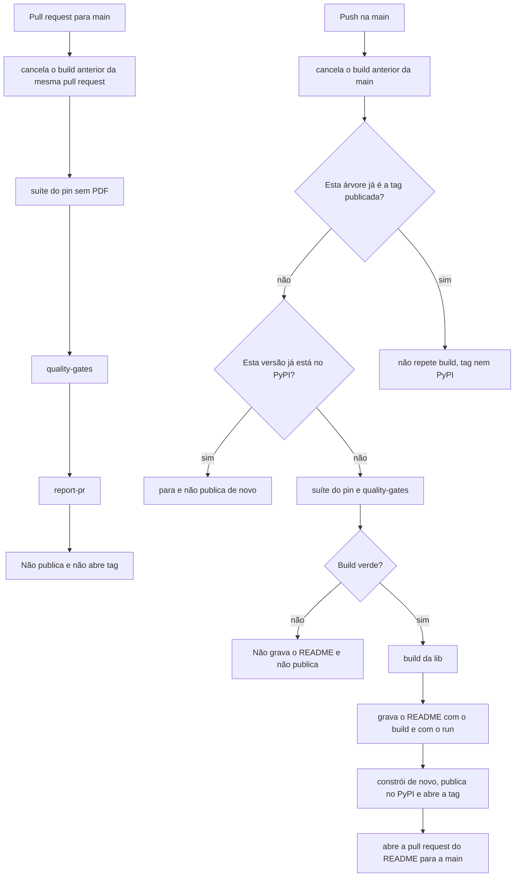

# Publicação do gerador de DANFSe

O push na `main` de uma versão que ainda não está no PyPI passa pelo quality gate e pela suíte do pin. No mesmo run faz o build da lib, grava o README com os insumos desse build e desse run, publica no PyPI, abre a tag `vX.Y.Z` e abre a pull request do README para a `main`. O merge seguinte encontra a versão no PyPI e na tag e não repete o build. O trigger da tag não publica. Não sobe para o Artifact Registry.

A suíte do pin não gera PDF. O README gravado por esse run diz isso. O render só entra quando houver uma suíte que compare com o folio do pin.

